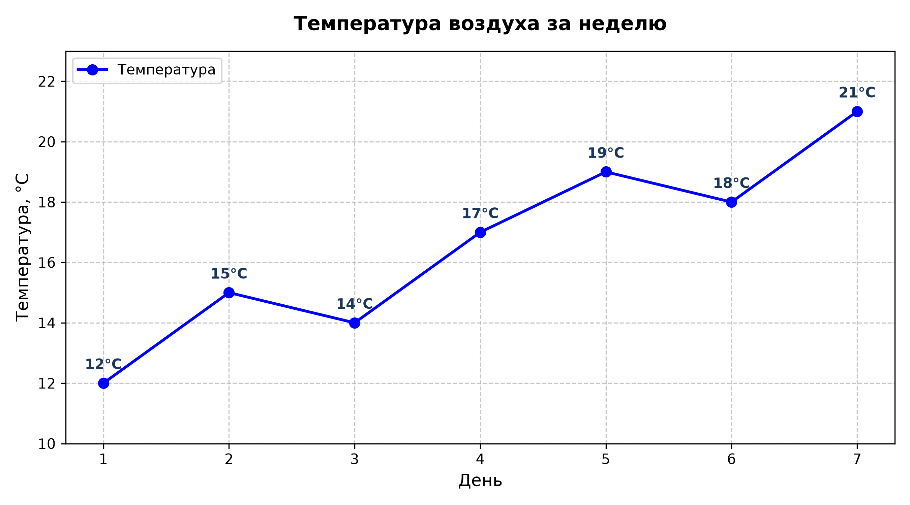
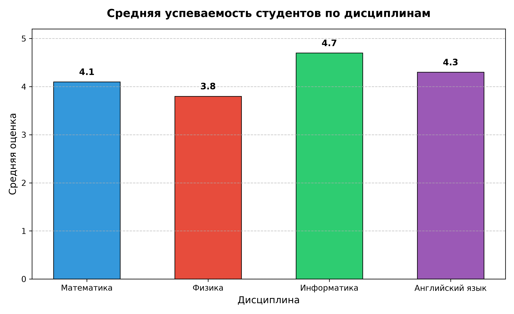
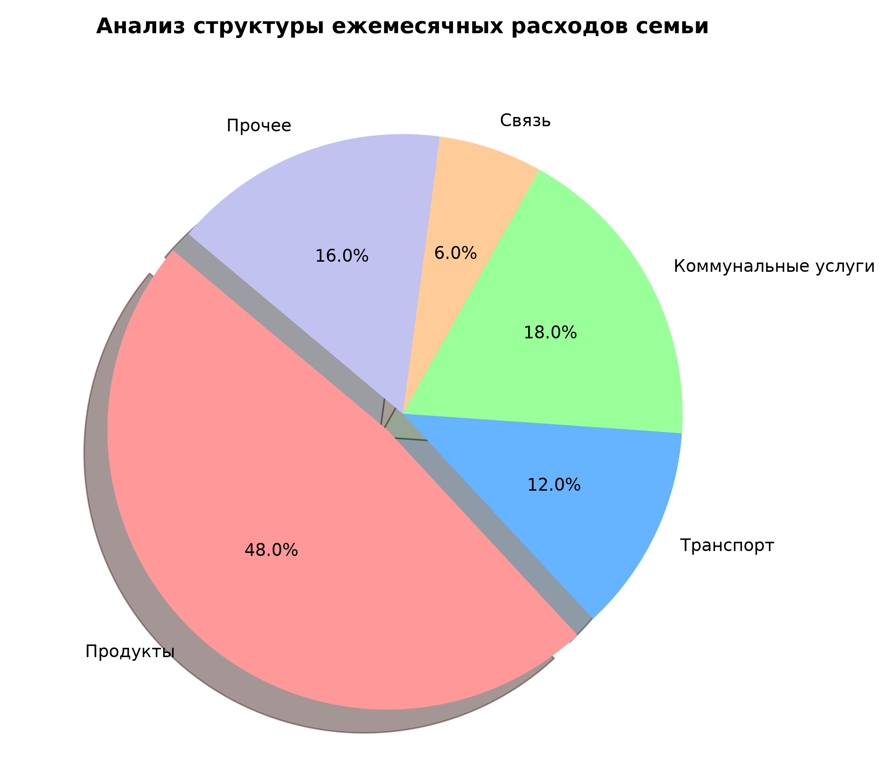
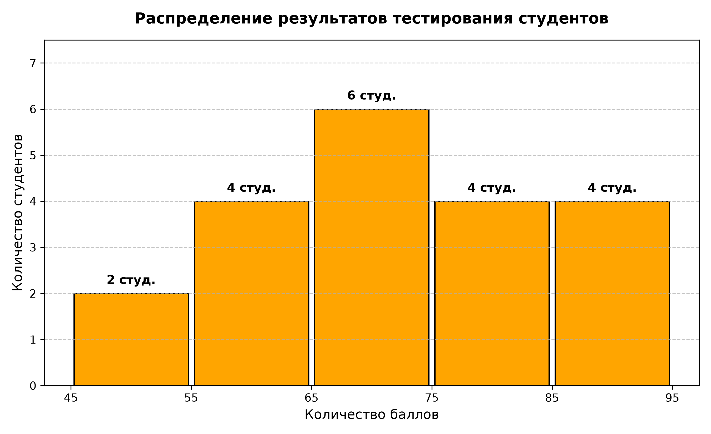
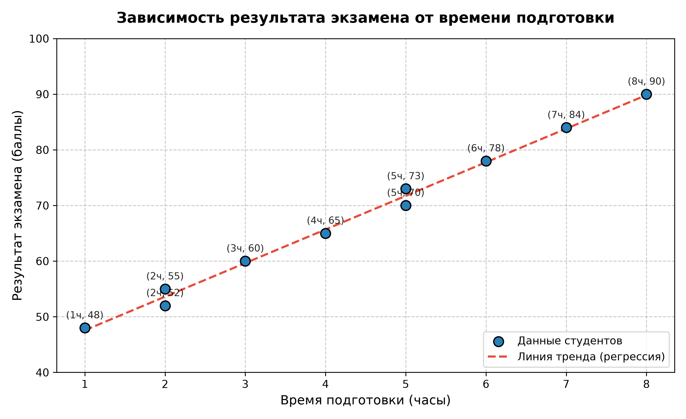

# Практическая работа: Визуализация данных с помощью Matplotlib

Данный репозиторий содержит решение пяти практических заданий по визуализации данных и статистическому анализу с использованием библиотеки **Matplotlib** в Python.

---

## Содержание
- [Структура проекта](#структура-проекта)
- [Установка и запуск](#установка-и-запуск)
- [Задание 1. Построение линейного графика](#задание-1-построение-линейного-графика)
- [Задание 2. Сравнение успеваемости](#задание-2-сравнение-успеваемости)
- [Задание 3. Анализ структуры расходов](#задание-3-анализ-структуры-расходов)
- [Задание 4. Исследование результатов тестирования](#задание-4-исследование-результатов-тестирования)
- [Задание 5. Исследование связи между показателями](#задание-5-исследование-связи-между-показателями)

---

## Структура проекта

```text
Matplotlib/
│
├── images/                           # Сохранённые графики в высоком разрешении (300 DPI)
│   ├── task1_line_plot.png
│   ├── task2_bar_chart.png
│   ├── task3_pie_chart.png
│   ├── task4_histogram.png
│   └── task5_scatter_plot.png
│
├── task1_line_plot.py                # Скрипт Задания 1
├── task2_bar_chart.py                # Скрипт Задания 2
├── task3_pie_chart.py                # Скрипт Задания 3
├── task4_histogram.py                # Скрипт Задания 4
├── task5_scatter_plot.py             # Скрипт Задания 5
│
├── main.py                           # Главный исполняемый скрипт (запуск всех 5 заданий)
├── Matplotlib_Tasks.ipynb            # Интерактивный Jupyter Notebook со всеми заданиями
├── requirements.txt                  # Список зависимостей
├── .gitignore                        # Исключения для Git
└── README.md                         # Документация и отчет по заданиям
```

---

## Установка и запуск

1. Клонируйте репозиторий:
   ```bash
   git clone https://github.com/On1kaze/Matplotlib.git
   cd Matplotlib
   ```

2. (Опционально) Создайте и активируйте виртуальное окружение:
   ```bash
   python -m venv .venv
   # Windows:
   .venv\Scripts\activate
   # Linux / macOS:
   source .venv/bin/activate
   ```

3. Установите зависимости:
   ```bash
   pip install -r requirements.txt
   ```

4. Запустите все задания сразу:
   ```bash
   python main.py
   ```
   Либо запускайте каждое задание отдельно:
   ```bash
   python task1_line_plot.py
   python task2_bar_chart.py
   python task3_pie_chart.py
   python task4_histogram.py
   python task5_scatter_plot.py
   ```

---

## Задание 1. Построение линейного графика

### Условие
Даны значения температуры воздуха за семь дней:
```python
days = [1, 2, 3, 4, 5, 6, 7]
temperature = [12, 15, 14, 17, 19, 18, 21]
```

### Требования
- Построить линейный график;
- Добавить маркеры точек;
- Установить синий цвет линии;
- Добавить название графика: «Температура воздуха за неделю»;
- Подписать оси: «День» и «Температура, °C»;
- Включить сетку.

### Результат


---

## Задание 2. Сравнение успеваемости

### Условие
Даны средние оценки студентов по дисциплинам:
```python
subjects = ['Математика', 'Физика', 'Информатика', 'Английский язык']
grades = [4.1, 3.8, 4.7, 4.3]
```

### Требования
- Построить столбчатую диаграмму;
- Использовать разные цвета для столбцов;
- Добавить заголовок и подпись вертикальной оси;
- Определить, по какому предмету средняя оценка самая высокая.

### Результат


### Аналитический вывод:
- **Самая высокая средняя оценка:** **4.7** баллов.
- **Дисциплина:** **«Информатика»**.

---

## Задание 3. Анализ структуры расходов

### Условие
Ежемесячные расходы семьи распределены следующим образом:
```python
categories = ['Продукты', 'Транспорт', 'Коммунальные услуги', 'Связь', 'Прочее']
expenses = [120000, 30000, 45000, 15000, 40000]
```

### Требования
- Построить круговую диаграмму;
- Отобразить названия категорий;
- Вывести процент каждой категории с помощью параметра `autopct`;
- Добавить заголовок;
- Определить, какая категория занимает наибольшую долю расходов.

### Результат


### Аналитический вывод:
- **Общий бюджет расходов:** 250 000 руб.
- **Наибольшую долю расходов занимает категория:** **«Продукты»** — **120 000 руб.** (**48.0%** от всех расходов семьи).

---

## Задание 4. Исследование результатов тестирования

### Условие
Даны результаты тестирования студентов:
```python
results = [45, 52, 55, 58, 60, 62, 65, 67, 70, 70,
           72, 74, 75, 78, 80, 82, 85, 88, 90, 95]
```

### Требования
- Построить гистограмму распределения результатов:
  - количество интервалов — 5 (`bins=5`);
  - цвет столбцов — оранжевый (`color='orange'`);
  - цвет границ — чёрный (`edgecolor='black'`);
  - горизонтальная ось — «Количество баллов»;
  - вертикальная ось — «Количество студентов».
- Сделать вывод: в каком диапазоне находится большинство результатов?

### Результат


### Аналитический вывод:
Распределение по интервалам:
- [45 – 55]: 2 студента
- [55 – 65]: 4 студента
- **[65 – 75]: 6 студентов**
- [75 – 85]: 4 студента
- [85 – 95]: 4 студента

> **Вывод:** Большинство результатов (**6 студентов**) находится в диапазоне **[65 – 75] баллов**.

---

## Задание 5. Исследование связи между показателями

### Условие
Дано количество часов подготовки и соответствующие результаты экзамена:
```python
hours = [1, 2, 2, 3, 4, 5, 5, 6, 7, 8]
scores = [48, 52, 55, 60, 65, 70, 73, 78, 84, 90]
```

### Требования
- Построить точечный график с помощью функции `scatter()`;
- Ответить на контрольные вопросы.

### Результат


### Ответы на контрольные вопросы:

1. **Какая связь наблюдается между временем подготовки и результатом?**
   > Наблюдается сильная прямая (положительная) линейная корреляция: с увеличением времени подготовки результаты экзамена устойчиво возрастают.

2. **Повышается ли результат при увеличении времени подготовки?**
   > Да, результат повышается. На графике видна четкая монотонно возрастающая зависимость: при минимальном времени подготовки (1 час) балл составляет 48, а при максимальном (8 часов) достигает 90 баллов.

3. **Можно ли на основании этого графика утверждать, что продолжительная подготовка является единственной причиной высокого результата?**
   > **Нет, нельзя.** В теории вероятностей и математической статистике наличие корреляции не доказывает исключительную причинно-следственную связь (*«корреляция не означает причинность»*). На экзаменационный балл влияет множество других факторов:
   > - начальный уровень знаний и базовые компетенции;
   > - индивидуальные когнитивные способности и скорость усвоения материала;
   > - методика и интенсивность обучения, качество учебных пособий;
   > - психологическое состояние, уровень стресса и физическое самочувствие в день экзамена.
   >
   > Длительная подготовка является важным фактором успеха, но не единственной его причиной.
